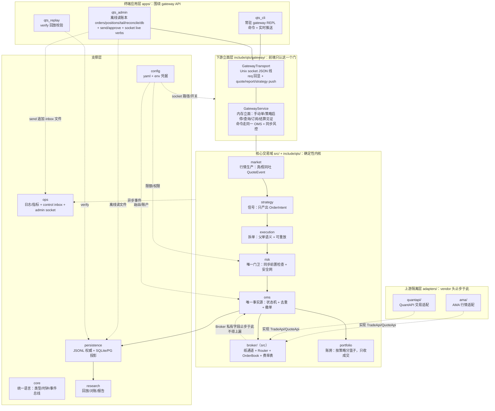
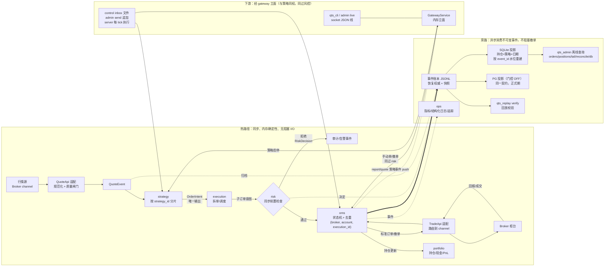

# QTS — Quantitative Trading System


一个面向多 Broker、多资产类别的事件驱动量化交易系统骨架（C++ 上限 C++17，当前单进程部署）。目标是让策略、执行算法、订单管理与风险控制共享统一领域模型，能够在历史回放、模拟撮合和实盘通道之间复用同一业务逻辑。

> 当前状态：策略/执行可配、风控、启动恢复与换日结算均已落地；支持长跑演示、离线查询/重放、日志文件和 SQLite 投影（持仓 × 策略 × 日期）。PostgreSQL 投影由 `QTS_ENABLE_PG` 门控，和默认后端遵循同一契约。默认构建提供完整 CTest 覆盖；真实 Broker 尚未接入，**不得用于实盘交易**。

## 设计目标

- **多通道接入**：用适配器隔离 FIX、REST、WebSocket 和各 Broker 专有 SDK。
- **统一交易语义**：核心只使用标准化的行情、订单、回报、持仓和风控模型。
- **A 股就绪的领域模型**：交易所、板块、股东账户、委托方式、价格带与交易时段均由标准模型和标的规则表达。
- **可验证性**：订单事件可记录、回放和重建；模拟与实盘共享 OMS、风控和策略接口。
- **风控优先**：所有新单/撤单在发送前经过同步交易前风控；提供分层 kill switch。
- **渐进式性能**：先保证正确性、可观测性与恢复能力，再针对已测得的瓶颈优化延迟。

## 快速开始

依赖：CMake 3.20+、支持 C++17 的编译器（Clang 5+、GCC 7+ 或 MSVC 19.15+）。默认构建不需要 Broker SDK 或 PostgreSQL；若工作区外不存在固定版本的 OSS 源码，CMake 会下载它们，因此首次配置需要网络。

推荐使用项目脚本完成本地门禁和纸交易演练：

```bash
./tools/qts.sh all       # Debug 构建 + 完整 CTest + paper drill
./tools/qts.sh demo      # 长跑演示，并输出对账、持仓和回放摘要
```

手动构建等价于：

```bash
cmake -S . -B build -DCMAKE_BUILD_TYPE=Debug -DQTS_ENABLE_WARNINGS_AS_ERRORS=ON
cmake --build build
ctest --test-dir build --output-on-failure
./bin/qts_server bin/cfg/paper.example.yaml
```

`bin/` 下可零参数开箱：`./qts_server` 读 `cfg/qts.yaml`（paper/simulated + 网关 socket），`./qts_cli` 读 `cfg/qts_app.yaml` 直连（account/strategy 预设，口令走 `$QTS_GW_PW`）；私有调整拷一份改，凭据永不提交（见运行手册 §13）。

构建产物统一落在 `bin/`；跟踪的配置位于 `bin/cfg/`，运行时生成的账本、数据库和日志位于 `bin/db/`、`bin/log/`。需要启用 Vendor SDK、PostgreSQL 或排查环境时，先执行 `./tools/qts.sh doctor`，再参阅[运行手册](docs/runbook.md)。

## 阅读路径

- 想运行或恢复纸交易实例：阅读[运行手册](docs/runbook.md)。
- 想理解分层、数据流和边界：阅读下方架构图及[系统架构](docs/architecture.md)。
- 想修改交易语义：先阅读[领域模型](docs/domain-model.md)和本文的“关键不变量”。
- 想了解已完成与后续工作：阅读[路线图](docs/roadmap.md)。

## 模块划分（与 `include/qts/` + `src/` 目录一一对应）

| 模块（目录） | 设计目的（一句话） | 功能（已落地） | 关键边界 |
| --- | --- | --- | --- |
| `core` | 全系统共享的无 Broker 词汇 | 定点 `Price/Quantity`、时钟（含 ManualClock）、`EventEnvelope`（event_id/trace_id/trade_date）、同步 `EventBus` | 不依赖 Broker SDK，不做 I/O |
| `config` | 配置与凭据分开管 | yaml 加载 + env 凭据（`QTS_QUANTAPI_*`/`QTS_AMA_*`）；操作员口令表已删，socket 权限即访问控制（ADR-048） | 上游身份证走 env，下游工牌跟配置 |
| `market` | 真/假行情都吐同一 `QuoteEvent` | `SimulatedQuoteFeed`（确定性游走，全 L1+故障注入 opt-in）/`FileQuoteFeed`、持有门、主数据/交易日历/A 股校验 | 只产行情，不发单 |
| `strategy` | 只表达意图，不碰钱和通道 | `strategy_api`（只产 `OrderIntent`）+ 网格 + 再平衡；多策略扇出（drill 只跑首策略保计数） | 不能直连 Broker |
| `execution` | 父单语义与可重放性 | TWAP/POV/VWAP/冰山/直通；子单 `<parent>#<seq>`、父链 trace 继承、`cancel_parent` 扇出/`replace_parent` 代际重规划（无原生 amend） | 把意图转子订单，保留父子关联 |
| `risk` | 唯一门卫，默认拒绝 | 价格带/仓位/频率/白名单/四级 kill + M13 安全网（连续拒单/拒单率/日亏，只置位排队不直接动手）；SIGHUP 热加载 | 所有新单/撤单进 `TradeApi` 前必过 |
| `oms` | 唯一订单事实源 | 状态机 + `(broker, account, execution_id)` 幂等去重 + 路由 + 撤单闭环 + 快照/重建/对账 diff（只 diff 不自愈） | 唯一状态迁移点 |
| `broker`（`src/`） | 纸通道与路由 | 双纸通道 + `Router : TradeApi`（加权选择/故障转移/内部分拆）+ `OrderBook` 仿真（opt-in）+ 整数 ppm 费率表；费用/注资进账本 | OMS 永远只持单个 `TradeApi` |
| `adapters/`（顶层） | 真通道隔离 | AMA 行情 + QuantAPI 交易；`QTS_ENABLE_VENDOR_SDKS` + `QTS_VENDOR_DIR` 门控，回调拷贝 + 单泵 `drain` | vendor 头永不进 `qts_core` |
| `gateway` | 下游统一立面（前端只认这一个门） | `GatewayService` 内存立面（手动单/策略启停/按账户查询/成交明细/子账户进度/订阅/结算见证，命令走同一 OMS+同步风控）+ `GatewayTransport`（Unix socket/TCP 双栈 JSON 线，每行一帧，`req` 回显 + push 推送；paper 免密，真 broker 账户凭口令登录绑账户全权） | 详见下方"下游接入"节 |
| `portfolio` | 账房，只收成交不发单 | 逐笔持仓/现金/PnL/费用；按策略分篮子（空 strategy 归 `passthrough`）+ `trade_date` 会话标签；T+1 可卖 + 活单预留 | 不发单；支持与柜台对账 |
| `persistence` | 黑匣子，JSONL 是恢复权威 | JSONL append + 异步 SQLite 投影（水位续传+幂等重建）+ 门控 PG（`QTS_ENABLE_PG`，同一契约）；热路径零 DB I/O | 其他库都是投影，可重建 |
| `research` | 裁判，生产与回放同一合约 | `Replayer`（固定步进+确定性种子）+ `verify` + 对账 diff + 纯函数报告 | 不碰实盘通道 |
| `ops` | 驾驶舱，不进热路径 | 结构化日志（stdout+file 双写）、指标接口、control inbox（零 IPC 文件，server 每 tick 执行）、admin socket、开关记账本 | 故障不得阻塞撤单 |

> 命名说明：`TradeApi`/`QuoteApi` 是本系统的内部端口契约（交易/行情各一），不是券商产品名；券商侧字段映射见 `resources/broker-mappings/`（如 AMA 行情 → `QuoteApi`，QuantAPI 交易 → `TradeApi`）。**channel** = 一套 `TradeApi` 接入点及凭据/会话/费率（同一 broker 可多通道）；**venue** = 仅指交易所市场规则层。QTS 是 server：上接 broker channel，下游前端应用（`qts_cli`/`qts_app`/…）经 `qts::gateway` API 接入。

### 系统模块架构图（节点第二行 = 设计目的，括号内 = 代码位置）



> 隔离规则：Vendor 头文件仅 `adapters/` 可见（`QTS_ENABLE_VENDOR_SDKS` 门控，默认 OFF），`core`/`strategy`/`execution`/`oms`/`risk` 绝不引用 Broker 私有字段；**channel** = 一套 `TradeApi` 接入点及凭据/会话/费率，**venue** = 仅指交易所市场规则层。

### 数据流图（热路径同步 / 旁路异步）



> 语义要点：每笔新单/撤单进 `TradeApi` 前必过 `risk`；超时 = 结果未知，只对账不判失败；空 `strategy_id` 在 OMS 入口归一到 `passthrough` 篮子；`trade_date` 会话标签随 envelope 落账本。

### 下游接入（`qts::gateway`，终端应用只调这里）

- **分层**：`GatewayService`（同步内存核，单测/演示/server 共用）+ `GatewayTransport`（异步 socket 壳，每行一 JSON 帧，`req` 回显、`push` 推送 quote/report/strategy）。server tick 线程拥有两者，订阅回调只收值拷贝、不得阻塞或重入。
- **Ops**：`ping | login | logout | whoami | submit | cancel | strategy_start | strategy_stop | strategy_list | strategy_progress | fills | cash | open_orders | find_order | positions_for | settle_report | settle_confirm | subscribe_* | unsubscribe`；paper 免密（socket 文件权限即访问控制），真 broker 账户凭券商口令登录并绑定该账户全权（ADR-050），无 scope；`cash/positions` 按账户读所属通道 book（真分账，`shared:false`），无接线时为共享视图。
- **三类终端**：`qts_cli`（常驻 REPL：一级菜单 login/buy/sell/strategy/account/quick + 命令 + 实时 push，`--socket`/`--tcp` 二选一，裸跑读 `cfg/qts_app.yaml`）、`qts_admin` live 动词（同一 socket/TCP 协议，一次一调 + `--account-id/--credential-env` 登录）+ `send`（control inbox 文件，零 IPC，cancel 走执行层扇出进账本）。
- **结算**：柜台为准、QTS 只自述不自证；`settle_confirm` 是见证事件（audit-only，重放只验格式，ADR-046）。

详细说明见[系统架构](docs/architecture.md)、[领域模型](docs/domain-model.md)、[路线图](docs/roadmap.md)和[运行手册](docs/runbook.md)。

## 目录

```text
.
├── adapters/             # vendor 门控适配器（ama 行情 / quantapi 交易，默认 OFF）
├── apps/                 # 进程入口：qts_server（长驻）/ qts_admin / qts_replay / qts_cli
├── bin/                  # 统一运行布局：构建产物 + cfg/（提交） + log/、db/（运行生成，不提交）
├── docs/                 # 架构、接口、运维与决策记录
├── include/qts/          # 对外头文件，按模块表分层（core/config/market/strategy/…/gateway/…）
├── resources/            # 协议映射、测试行情数据（运行配置见 bin/cfg/）
├── src/                  # 库实现（与 include/qts/ 一一对应，单 qts_core 库）
├── tests/                # unit / integration / bench
└── vendor/               # 进仓 broker SDK（include/+lib/，私有仓限定，ADR-040）
```

## 技术选型

**现在（默认构建，零系统依赖）**：C++17（为上限：兼容老版本操作系统和编译器，`filesystem` 直接用标准库）、CMake 3.20+；yaml-cpp 0.8.0、nlohmann/json v3.11.3、SQLite amalgamation 3.51.1，全部经 FetchContent pin 版本（离线可覆盖，ADR-021/035）。单 `qts_core` 库 + 四个二进制（server/admin/replay/cli）。

**门控（默认 OFF）**：vendor SDK（`QTS_ENABLE_VENDOR_SDKS` + `QTS_VENDOR_DIR`，AMA/QuantAPI，头文件仅 `adapters/` 可见）与 PostgreSQL（`QTS_ENABLE_PG`，系统 libpq，同一 `EventStore` 契约，ADR-038）。

**正式期待定**：ClickHouse/对象存储（研究数据）、OpenTelemetry 指标追踪、RBAC（当前 socket 文件权限即访问控制，ADR-048）。新依赖须审批，继续走 FetchContent pin，不 vendoring 进仓。

上述"渐进式性能"原则不变：先保证正确性、可观测性与恢复能力，再针对已测得的瓶颈优化延迟。

## 关键不变量

1. Broker 专有字段不得泄漏到 `core`、`strategy`、`execution`、`oms` 或 `risk`。
2. 每一订单状态迁移都必须是合法、可追溯、幂等的。
3. 未通过交易前风控的请求绝不进入 Broker 适配器。
4. 订单命令、Broker 回报与风控决定应可关联至同一追踪 ID。
5. 策略在回放、仿真和实盘中使用相同的策略接口。

## 安全提示

本项目不包含投资建议或生产交易授权。真实资金接入前，必须完成回放测试、演练环境验证、Broker 对账、权限控制、灾难恢复演练和人工审批流程。
