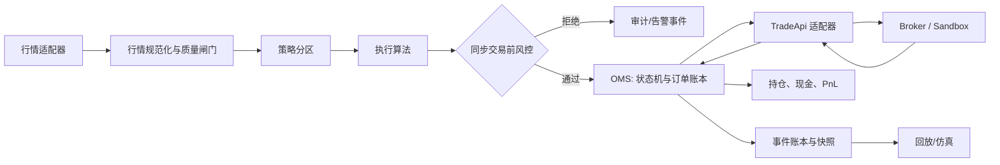

# STS 开发方案与维护台账

> 本文是项目的执行基线，而不是愿景清单。每完成一个小目标、确认一项架构决定或改变状态，必须在本文件更新日期、证据和下一步；未经记录的决定不应成为隐性约束。
>
> 术语约定（2026-10-01，维护者）：本文档与代码注释中的 **"Linux 环境"（vendor 环境）** 指 Linux x86_64 + gcc-toolset-11 + `STS_VENDOR_DIR` 指向 vendor SDK 的构建/测试/联调环境。开发机形态不锁定（Mac + OrbStack 虚拟机、物理机、云主机均可），**不得以 "VM" 作为其通称**；历史记录中保留的 OrbStack/Alma8 字样是当时实例的事实记述（见 §7 术语台账行）。
>
> 术语约定（2026-10-01，维护者）：**channel（通道）= 一套 TradeAPI 接入点的通称** —— 一个交易系统 API 实例及其凭据/会话/业务功能范围/费率与时延特性，**形态无关**：A 股 broker（交易所会员）柜台（同一 broker 可多通道，如世纪证券的 KDVIP 与 QuantAPI 双柜台并存、功能范围与速度各异）、期货 CTP、数字货币交易所直连 API 都是 channel。channel 是路由与统计（fee/fill/latency）的最小维度，凭据 env 按通道分（`STS_QUANTAPI_*`/`STS_AMA_*`）。**venue 仅指交易所/市场规则层**（tick/lot/涨跌停/交易所改单能力）；历史上误用 venue 指柜台/路由目标的代码与文档已统一改名 channel（2026-10-01，决议实质不变，见 §7）。行情域字段 `channel`（AMA tick 频道号、`channel_mode`）为 vendor 原生字段名，按域与端口方法 `channel()` 区分。模块目录 `include/sts/broker`/`src/broker` 与 `SimulatedBroker` 等类名**暂保留** —— 可见未来接入的 AMA/QuantAPI/KDVIP 均为 broker 柜台，名副其实；改名评估与触发条件见 §7。

## 1. 目标、边界与非目标

STS（Strategy Trading System，策略交易系统）是一个事件驱动交易系统内核（C++ 以 C++17 为上限：兼容老版本操作系统和编译器，`filesystem` 直接用标准库，不引入第三方）。它应使策略、回放、模拟交易与实盘交易共享领域语言、风控判定和 OMS 状态机，并能在故障后从确定的事件记录恢复。

定位（维护者，2026-10-01，当前倾向）：**私募（买方）策略交易系统** —— 以自有账户经券商柜台接入市场，一般一个 broker 对接一个 TradeAPI、多 broker 账户可并存；不是券商内部多柜台运营系统。该定位与本节单账户范围、README"面向多 Broker"、凭据 env 由我方持有的形态自洽，并支持既有术语与模块决策（`sts/broker` 模块名保留，词汇判据与后果见 §7）。

首个可发布版本的范围是：单账户、单一 sandbox/paper Broker、股票/现货类线性产品、限价与市价单、单进程部署的 gateway（当前部署形态；多线程/多进程/分布式随系统成熟度和业务场景演进，拓扑无关的不变量是 OMS 唯一状态迁移与同步风控）。系统不提供投资建议，也不应在未完成对账、权限、演练和人工审批前连接真实资金。

真实 broker 通道的接入目标不止华锐 AMA/QuantAPI：CSP 系统已对接的金证 KDVIP 等柜台通道同属 STS 接入范围（维护者声明，2026-10-01，见 §7）。每家通道按 `adapters/<vendor>` 逐里程碑立项，沿用 ADR-027/033 的 vendor 门与 seam 单测模式；研究输入为 CSP `channel` 模块及其随附 SDK（`csp/code/common/3rd/kdvip_cli_sdk` 等）。

以下内容明确不属于当前内核：预测模型、优化器、用户界面、无锁/内核旁路等未由 SLA 证明必要的低延迟优化，以及将 Broker 私有模型暴露给策略。

## 2. 目标架构



交易热路径只包含确定性、内存内计算：行情 → 策略 → 执行 → 风控 → OMS → 适配器。热路径不得同步读取数据库、远程配置或执行可能无限期阻塞的 I/O。审计、指标、日志、报表和落库由异步数据路径消费不可变事件；撤单和风控减仓优先级高于新单。

初期在一个进程中部署，但按职责分区：I/O 线程仅解析/投递；同一账户订单固定落在一个 OMS 串行分区；策略按 `strategy_id` 分区。扩展为多进程时，端口契约和事件格式保持不变，持久化事件流是恢复权威。

## 3. 核心契约与不变量

| 边界 | 输入 | 输出 | 责任 |
| --- | --- | --- | --- |
| `strategy` | 规范化行情、组合快照 | `OrderIntent` | 只表达意图，不直接交易 |
| `execution` | `OrderIntent` | 子订单意图 | 拆单/调度，保留父子关联 |
| `risk` | 意图、限额、行情/持仓快照 | 可审计 `RiskDecision` | 默认拒绝不可用或陈旧输入 |
| `oms` | 通过风控的意图、Broker 回报 | 权威订单快照、领域事件 | 唯一状态迁移点、幂等与撤单 |
| `broker` | 标准订单/撤单 | 标准化回报 | 协议、会话、重试、外部映射与原始消息关联 |
| `portfolio` | 已接受成交 | 持仓、现金、PnL | 不发单；支持与外部对账 |

必须持续保持：

1. Broker 私有字段不得进入 `core`、`strategy`、`execution`、`oms` 或 `risk`。
2. 每个订单有全局订单 ID、客户端幂等键和追踪 ID；每个外部回报有稳定执行 ID。
3. 只有 OMS 可改变订单状态；重复回报不能重复增加成交；未知或冲突回报必须保留给对账/告警而非静默接受。
4. 所有新单和撤单请求在进入 `TradeApi` 前经同步风险检查；风控、账户、策略和全局 kill switch 均可阻断新风险。（改价改单推迟到执行算法落地，见 ADR-020）
5. 重放、模拟和实盘复用相同的 `OrderIntent`、风控和 OMS 接口。时间、随机种子、配置版本与数据版本可被记录。

## 4. 订单、恢复与故障语义

订单状态为 `PendingNew → Live → PartiallyFilled → Filled`，并允许 `Live/PartiallyFilled → PendingCancel → Cancelled`；撤单未确认前的成交可使 `PendingCancel → PartiallyFilled/Filled`。终态为 `Filled`、`Cancelled`、`Rejected`，只能接受等价重放，不能再转换。

每次状态迁移写出包含 `event_id`、`trace_id`、订单版本、接收时间、Broker 时间、配置/规则版本和原始消息引用的不可变事件。为避免重复成交，OMS 以 `(broker, account, execution_id)` 去重；没有稳定执行 ID 的接入不得进入生产模式。快照仅用于加速：重启时加载最近快照、回放后续事件、查询未终结订单，并以 Broker 事实进行对账。网络超时代表“结果未知”，绝不等同于“委托失败”。

| 场景 | 行为 |
| --- | --- |
| 行情陈旧或质量异常 | 默认停止开仓；是否允许减仓由显式规则决定 |
| Broker 断线 | 冻结新单，保留取消/查询恢复通道；重连后对账 |
| 风控不可用 | 拒绝新风险；受控减仓路径需要独立批准和审计 |
| 事件账本不可用 | 不允许无审计新单；优先确保撤单和风险平仓可执行 |
| OMS 重启 | 快照 + 回放 + 未终结订单查询 + 差异告警 |

## 5. 分阶段实施与验收

### M0：工程与模型基线

- 明确内部 `TradeApi` 与 `QuoteApi` 端口；Broker 的 REST/FIX/WebSocket/SDK 只能在适配器层实现端口，不得被核心模块引用。
- 面向中国 A 股：内部订单携带交易所、板块、股东账户、业务类型、市价委托方式和保护限价；交易规则由标的主数据驱动。
- `TradeApi` 的控制面包含资金/持仓快照和未终结订单恢复查询；必须提供可卖、冻结及可取资金，不可由总持仓或总资金推算。
- 统一定点 `Price/Quantity`，补充 `trace_id`、执行 ID、累计成交与订单版本。
- 固化合法状态迁移、回报幂等、冲突订单 ID 拒绝和撤单闭环。
- 保持无外部依赖的 CMake/CTest 可重复构建。

验收：Debug 构建在警告开启时无警告；单测覆盖风险拒绝、重复提交、部分成交去重、订单 ID 冲突、撤单状态迁移和非法迁移。

### M1：单 Broker paper 闭环

- 引入 `QuoteApi` 行情适配、行情序列/时间质量检查和 `Instrument` 元数据。
- 为实际 sandbox 建立显式字段映射、认证/重连/限流、请求幂等和原始消息审计。
- 建立 A 股标的主数据、交易日历、停复牌/价格带状态、T+1 可卖数量和公司行为处理；产品差异由规则驱动。
- 实现事件账本接口、快照、启动恢复、未终结订单查询与 Broker 对账。
- 将风控扩展为价格带、仓位、频率、白名单和四级 kill switch。

验收：断线、超时、重复回报、进程重启和对账差异均由自动化集成测试覆盖；只使用 sandbox/paper 账户。

### M2：研究与回放一致性

- 可控时钟、事件回放器、模拟撮合、手续费/滑点/延迟模型和确定性随机种子。
- `portfolio` 持仓/现金/PnL 与交易日结算模型；生成交易、风险和回撤报告。
- 记录配置和数据版本，保证同一输入可复现相同输出。

验收：同一事件流至少两次回放结果逐字段一致；生产路径与回放路径使用同一策略、风控和 OMS 合约。

### M3：生产运行能力与多 Broker

- 第二个 Broker 适配器验证精度、订单类型、状态码和会话恢复差异。
- 接入 PostgreSQL/ClickHouse/对象存储、OpenTelemetry、指标、告警、密钥与 RBAC。
- 实现部署、灰度、容量、灾难恢复与人工运行手册。

验收：多适配器切换不改变策略语义；恢复、权限、对账和告警演练有可复核记录。

#### M3 执行切分（ADR-021，零 infra 先行）

- M3-0 依赖机制：FetchContent pin 版本，首批 yaml-cpp；网关改读 `paper.example.yaml`（关闭 ADR-011 欠账）。
- M3-1 文件账本：nlohmann/json（single-header）JSONL 账本，重启从文件恢复走 e2e。
- M3-2 第二自研适配器：差异 tick/手数/会话语义，同一策略双适配器语义一致测试。
- M3-3 可观测与密钥政策：指标接口、stdout 结构化日志、密钥 env 化 + CI 密钥扫描。
- M3-4 部署演练手册：本地 compose 预留位、灾难恢复步骤文档化。
- PG 投影已落地（ADR-038，见台账 2026-10-10）；ClickHouse/OTel 真家伙与真实 Broker 仍后置，需 infra 就绪后单独立项。
### M4：执行算法（ADR-023，零 infra 先行）

- M4-0 执行端口+直通：`ExecutionAlgorithm`（`add_parent/poll/on_quote/on_execution_report`），子单 `<parent>#<seq>`、父链与 trace 继承；网关/Replayer 全接线。
- M4-1 TWAP：定时切片+锚定首 poll+稀疏追赶+小单钳位。
- M4-2 POV/VWAP：`on_quote`行情喂入，POV 跟量、VWAP 走显式曲线。
- M4-3 冰山：峰值显示+成交驱动刷新+部分撤单回隐量。
- M4-4 父子生命周期：`cancel_parent`扇出+`replace_parent`代际重规划（ADR-024，无原生 amend）；回放回报转发补齐，冰山跨 bar 刷新。
- 智能路由/多进程/压测门禁后置（见 ADR-025）。

验收：同一父单序列+同一 poll 时刻 => 同一子单输出（回放与 paper 一致）；关 M4 时 `ctest 16/16`。

### M5：生产加固（零依赖）

- M5-1 网关账本二选一：`AppConfig.ledger_file`，空走内存 drill，设路径经 `FileEventLedger` 跨重启追加。
- M5-2 热路径吞吐基线：`sts_bench_throughput`（2 万直通子单/无账本），只记录不设硬门禁；本机 Debug 约 12 万单/秒。
- M5-3 tidy 转硬门禁：删 `continue-on-error`，CI 六 job 全绿关闭。

### M6：订单簿仿真（ADR-025，零 infra 先行）

- M6-0 盘口深度（opt-in）：`OrderBook::take`，限价只吃盘内档、市价扫单、VWAP 均价；paper 整吃 fill、部分吃留活可撤；执行 ID 按笔后缀防 OMS 去重坍缩；未设盘口走参考价老路径。
- M6-1 静置单再撮合：`set_order_book` 按提交序重吃新深度；`request_open_orders` 对部分成交重报 partial+累计，新 OMS 可收敛。
- 智能路由/多进程后置，需真实需求或第二真实 channel 出现再立项。

验收：`ctest 17/17`（`WERROR`+UBSan），网关 drill `6/18/0` 不变；静置语义以 `sts_test_paper` 9 组 book 用例为准。

### M7：AMA 行情适配（ADR-027，零 infra 先行，已收尾）

- M7-0 快照归一化：`MDSnapshot` → `QuoteEvent`（精度/阶段码/sequence 合成/质量门），数据源用录制 fixture，不链 vendor `.so`，CI 可跑。
- M7-1 逐笔链路：序列跟踪 + 方向/类型映射（ADR-028 端口决策：逐笔不进 `QuoteEvent`，缺口走 `QueryMDTick` 回补；本地簿重建待真实 feed，归 M7-2 联调）。
- M7-2 真 SDK 接线：vendor `.so` + UMS env + 联调（含本地簿重建验证，需 infra/券商账号就绪后单独立项）。
- 后续扩展（预留，见 §1 范围与 §7 台账）：多柜台通道接入 —— CSP 已对接的 KDVIP 等；待 M7-2 收口且 SDK/账号/环境就绪后逐家立 `adapters/<vendor>` 里程碑，形态与验收沿用 ADR-033（vendor 门 + seam 单测 + 只读工具冒烟）。研究段已完成（2026-10-01）：`resources/broker-mappings/kdvip.md`（SDK 头 + CSP 实现双路只读研究，未链接 SDK）；方式定案"抄逻辑不抄架构" —— 不整体移植 CSP/channel（评估见该文档 §7，推翻需 ADR）。
- 港股 `Exchange` 枚举扩展后置，需领域先扩展再映射。
- 状态：M7-0/M7-1 关闭；M7-2a 环境就绪（2026-10-01，见台账：Linux 环境构建 ctest 20/20 + `.so` dlopen OK + 网关 TCP 双端可达）；M7-2b 适配器代码交付 + Linux 环境 vendor 构建验证（2026-10-01，ADR-033，`ctest 21/21` + 冒烟 exit 1 符合契约），真实联调待 UMS 地址/账号 env/交易日窗口；M7-2c QuantAPI 适配器代码交付 + Linux 环境 vendor 构建验证（2026-10-01，ADR-032/033，仅 TCP，`ctest 22/22` + 工具冒烟 exit 0/2 符合契约），真实联调待账号 env/交易日窗口；M7-2d 受控交易待后续段（单次人工批准）；港股枚举后置（见上）。**实盘接口测试首轮（2026-10-09，见台账）**：QuantAPI V2.7.1.2（`10014939`/`172.16.109.17:32001`）只读链路一次通过（登录 + 资金快照 6 持仓，exit 0）；AMA（`amatest`/`172.16.109.14:8200`）会话已通（connected + 订阅下发），挖出上线信号真 bug 一处（TCP 流程以上线码 24 为准，UMS 层码永不到）并修复，快照流验证待开盘窗口。

验收：`ctest 19/19`（`WERROR`+UBSan），网关 drill 不变；真 SDK 接线前核心不得引用 vendor 头文件。

### M8：智能路由（ADR-030，零 infra 先行，已收尾）

- M8-0 路由选择 + 故障转移：`ChannelStats` 输入口（配置文件版：确定费率 + 昨日成交率/时延）+ 加权 `RoutingPolicy` + `Router : TradeApi`（选择/`exec_id` channel 命名空间/cancel 映射/查询扇出/恢复聚合），paper 双 channel 单测；OMS 零改动。
- M8-1 Router 内拆单（ADR-031）：按 `split_weight` pro-rata，子单 `<parent>#<i>`，父级回报合成，累计拼合。
- M8-2 在线测算：`ChannelMeter` 按单 EWMA 成交率/时延（首 ack 计时、终态按单结算，`cum==ordered` 视同完成），昨日值作种子与回退（无时钟/无样本/重启恢复噪声时保持种子，从不编造）；`ewma_alpha_bps` 可配（默认 2000）；选择前刷新，拆分子单按通道分别计量；`channel_stats()` 快照供查询。
- 后置：真实费率表接入与真实双 channel 验证。
- 状态：M8-0/M8-1/M8-2 关闭，真实验证后置。

验收：`ctest 20/20`（`WERROR`+UBSan），网关 drill 不变；无 channel 可用时合成为 `Rejected` 回报（不断静默）。

### M9：演示线与 SQLite 落库（ADR-034，休市窗口执行，与 M7-2 并行）

- 背景：维护者愿望 = 程序启动长跑、模拟行情/通道下持续下单与查询、日志文件与数据库可见。现状已覆盖一次性 drill（脚本行情 → 策略下单 → 模拟撮合 → JSONL 账本 → stdout 结构化日志；2026-10-01 现场演示：6 单全成、18 事件、对账干净），本里程碑补"长跑 + 运行时查询 + 日志落文件 + SQLite 数据库"。
- M9-0 持续模拟行情源 + gateway 长跑：`SimulatedQuoteFeed`（定时驱动价格游走，复用既有模拟撮合路径）+ **长跑 opt-in**（默认一次性 drill 行为不变，沿 M6-0 opt-in 先例）+ SIGINT 优雅停机（终轮对账 → 报告 → exit 0）。
- M9-1 日志文件 sink：`log.file` 配置项，结构化 JSON 追加落文件；默认 stdout 不变。
- M9-2 admin 查询 CLI（`sts_admin`）：**读账本文件的离线查询器**（`orders`/`positions`/`tail`/`reconcile`，零 IPC —— JSONL append-only 天然支持长跑中并发读尾部），兑现 README 预留的 admin 进程入口；`db` 子命令显示 SQLite 水位与表统计。
- M9-3 SQLite 落库（当前库，PG 为正式期）：**JSONL 事件流仍为恢复权威，SQLite 是异步投影查询库** —— ledger append → 队列 → worker 线程写库（§2 异步数据路径，热路径零 DB I/O）；启动按 `event_id` 水位续传、全量重建幂等；表 = `events`（全量 payload 可回溯）+ `orders`/`executions` 投影；依赖经 FetchContent pin SQLite amalgamation（ADR-021 机制，零系统依赖、CI 全绿）；**schema 用可移植标准 SQL，PG 同位替换后置**（ADR-021"真库待 infra"演进为 SQLite（现在）→ PG（正式））。
- 后置：PG 落库与 compose 槽位启用、`sts_admin` 经本地 socket 查询运行中 gateway（读文件已够演示）、报表/指标落库。
- 状态：已落地（2026-10-01）：M9-0 长跑（opt-in，默认 drill `6/18/0` 不变，SIGINT 优雅停机 exit 0）+ M9-1 `log.file` 双写 + M9-2 `sts_admin`（orders/positions/tail/reconcile/db，零 IPC）+ M9-3 SQLite 异步投影（FetchContent pin 3.51.1 amalgamation，水位续传+幂等重建，`events/orders/executions`）；`ctest 21/21`，500-tick 演示 228 单全成、对账干净。

验收：`ctest` 全绿（新增投影/水位续传/停机用例）+ 默认 drill 行为不变 + 端到端演示：启动长跑 → 模拟行情持续下单撮合 → 另一终端 `sts_admin` 查询与 OMS 一致 → `log.file` 落盘 → sqlite3/DBeaver 打开库可见 `events/orders/executions`；runbook 补"演示"章节。

### M10：生产化（进行中，零真实通道依赖）

- 风控通电：持仓/频率/开关/T+1/日亏熔断在实盘循环生效 + SIGHUP 热加载（限额/开关/频率/日志级别）。
- 策略/执行可配：网格参数 + 五算法切换 + 单号跨重启唯一；策略归属域模型（ADR-036：单单必属一策略，持仓按策略分篮子，交易日期落库）。
- 运行能力：通道选择 yaml 驱动、启动恢复、换日结算、盘口实盘化、有序停机、在线状态快照、纸通道保真度可配、断线冻结/恢复/混沌演练、磁盘保留与快照轮转、自动备份与恢复演练。
- 数据库：SQLite 继续（PG 正式期后置，schema 可移植标准 SQL）。

验收（滚动）：双构建 `ctest` 全绿（`WERROR`+UBSan，另有 ASan/TSan job）+ `FORMAT_CLEAN` + CI 全绿 + 默认 drill `6/18/0` 不变（当前 `30/30`）。

### M11：模拟业务保真（已落地，零真实通道依赖）

- M11-0 L1 行情保真 + 质量门：`SimulatedQuoteFeed` 发全 L1（买一/卖一/涨跌停/阶段/序列），`auction/halt/stale/crossed` 全 opt-in，脏报价hold 新单只保留撤单/查询。
- M11-1 标的主数据 + 期初库存：`instruments` 主数据（tick/lot/band/身份，空=宽松老路径）+ `paper_sim.starting_positions`（已结算可卖，现金不动）。
- M11-2 AMA 双源：`demo.feed: simulated|ama`，ama 按主数据逐标的经生产 `Normalizer`+`TickSequenceTracker`，真 L10 深度进纸通道实盘化。
- M11-3 多策略并发 + 执行真实轮转：长跑扇出全部 enabled 策略（drill 保持首策略，计数不变）+ 切片保留活父单 + `open_parent_ids` + 停机经执行层扇出 + 五算法网关式集成测试。
- M11-4 在线干预：`control.inbox` 零 IPC（`sts_admin send` 追加，网关每 tick 执行，cancel 走执行层扇出进账本，开关类记结构化日志）。
- M11-5 A 股费率表：整数 ppm（佣金双边+最低/印花卖方/过户双边），双纸通道应用，缺省保持老 commission 行为。
- M11-6 费用进账本 + 独立费率文件：`ExecutionReport.fee` 随成交进账本（JSONL/SQLite/verify 全链）+ `fee_file`（default+分标的覆盖，调费率不动主配置）。
- M11-7 注资进账本：`funding_deposited` 事件（现金 leg + 逐笔期初库存，fresh ledger 才追加，重启不重复），admin/SQLite/verify 重放即完整账本；附带修重启 segfault 真 bug 一处（`EventBus` 加 token 退订，查询采集闭包悬空 UAF）。
- M11-8 多标的多策略演示 + T+1 卖出预留：`demo-multi.yaml`（AMA 双标的 × 网格×2 + 再平衡×1，`seed: 7`）+ `starting_positions[].strategy` 按策略注资 + 活单预留可卖（并发活卖不再超卖）+ 关机撤单排序（同种子逐事件一致）。

验收：双构建 `ctest 31/31`（`WERROR`+UBSan，另有 ASan/TSan job）+ `FORMAT_CLEAN` + CI 全绿 + 默认 drill `6/18/0` 不变。

## 6. 决策记录

| ID | 日期 | 决定 | 状态 | 理由/影响 |
| --- | --- | --- | --- | --- |
| ADR-001 | 2026-09-23 | 核心保持 C++20 + 标准库，外部运行依赖后置 | 被 ADR-009 取代 | 先确保领域模型可测试、可离线构建 |
| ADR-002 | 2026-09-23 | OMS 是订单状态唯一事实源 | 已确认 | 防止适配器、策略和持仓各自改变订单状态 |
| ADR-003 | 2026-09-23 | 价格和数量使用定点整数 | 已确认 | 避免浮点误差；每个标的的刻度由元数据定义 |
| ADR-004 | 2026-09-23 | 超时状态为未知并触发恢复/对账 | 已确认 | 禁止将网络故障误判为下单失败 |
| ADR-005 | 2026-09-23 | 真实 Broker、数据存储和 RPC 只在 M1/M3 按需引入 | 已确认 | 降低当前骨架的安装与运行风险 |
| ADR-006 | 2026-09-23 | 内部通道拆分为 `TradeApi` 和 `QuoteApi` | 已确认 | 交易与行情有独立连接、故障和扩缩容语义；OMS 只依赖 `TradeApi` |
| ADR-007 | 2026-09-23 | A 股交易规则以版本化 `InstrumentRules` 注入校验器，不硬编码在 OMS | 已确认 | 主板、科创板、创业板及交易所规则存在差异且会变化；适配器只转换协议字段 |
| ADR-008 | 2026-09-23 | 资金、可卖持仓和恢复查询属于 `TradeApi` 控制面 | 已确认 | A 股现金、冻结及可卖数量不能由订单账本推导；查询不可置于交易热路径 |
| ADR-009 | 2026-09-24 | 核心标准降为 C++17，CMake 最低版本降为 3.20 | 已确认 | 全仓仅 2 处 C++20 `contains()`，已改为 `find()`；老系统适配，`string_view/scoped_lock/[[nodiscard]]` 保留 |
| ADR-010 | 2026-09-24 | 冻结 `Clock`/`EventEnvelope`/`EventIdGenerator` 与风控链路（分级 kill switch + 注入式 A 股规则）接口 | 已确认 | 回放确定性要求可控时钟与可复现事件 ID；`check_ashare` 无规则时 fail-closed；`EventBus` 保持同步语义，M1 异步账本消费同一事件 |
| ADR-011 | 2026-09-24 | 配置契约以 `config.hpp` 为准，文件解析重规划为 M3 前置项 | 已修订 | 原计划“随首个 sandbox 适配器引入”已腐烂（首个适配器是自研零依赖）；改为 M3 前经 FetchContent pin yaml-cpp，网关 drill 改读文件；此前配置保持编程构造 |
| ADR-012 | 2026-09-24 | 首个 sandbox 选自研 paper 引擎（零外部依赖），`SimulatedBroker` 升级为同步确定性撮合 | 已确认 | 维护者决策；先 ack 后按参考价整手成交、无价则挂单；断线抛异常、重连仅翻标志（同步投递无队列）；持仓/现金为简易账本，成本与 T+1 可卖留待 M2 结算模型 |
| ADR-013 | 2026-09-24 | 账本接口 `EventLedger`+`InMemoryEventLedger`，OMS 可选接入并暴露恢复面 | 已确认 | 账本分配 event_id 保证顺序；OMS 存全量 intent 以支持重建；无操作去重不记账；对账只 diff 不自愈，由恢复驱动决策；文件持久化归 M3 |
| ADR-014 | 2026-09-24 | 风控扩展价格带/仓位/频率/白名单与标的级 kill switch（四级） | 已确认 | 频控按 ManualClock 滑动窗口、仅统计通过前置门的新单；仓位用溢出安全比较；白名单空=全放行；`max_position_quantity` 置 RiskLimits 末尾以兼容旧初始化 |
| ADR-015 | 2026-09-24 | M1 以自研网格策略端到端演练收口，策略仅产 OrderIntent | 已确认 | 每 level 独立买低卖高翻转、一格止盈；顶 level 卖目标出界永不触发、属已知边界；网关 drill  script 化价格路径，拒绝/对账脏即非零退出 |
| ADR-016 | 2026-09-24 | M2 回放器：固定步进 ManualClock + 参考价对齐 + 策略直驱 OMS | 已确认 | 同一行情两次运行逐字段一致即达标；paper 按参考价成交（限价单可能 price improvement），现金黄金值须按成交价手算；replayer 只计 accepted 提交 |
| ADR-017 | 2026-09-24 | paper 延迟/滑点/费率模型：事件时撮合、投递时 OMS 可见 | 已确认 | 延迟队列按时钟投递、断线 holding、重连 flush（修订 ADR-012 无队列假设）；滑点按 unit 固定惩罚 taker；费用按 bp 整算并累计；未 ack 订单不可撤；Replayer 每 bar 顺手 deliver_due |
| ADR-018 | 2026-09-24 | 组合账本归 `Portfolio`，paper 快照吃组合数据 | 已确认 | 按成交逐笔喂入（调用方保序、非幂等）；卖按比例释放成本、打平清零；T+1 可卖=总量-当日买（下限 0），卖出须走可卖库存但暂不强制；替换 M1-2 sellable=total 临时语义 |
| ADR-019 | 2026-09-24 | 回放报告为消费账本的纯函数，版本一致即实验可重现 | 已确认 | 终态按单去重计数；拒绝进直方图；回撤基于毛成交序列、不含持仓盯市（待 M4 行情源）；费用对账本不可见、留在组合/券商侧 |
| ADR-020 | 2026-09-24 | 改单（amend）推迟到执行算法落地（M4），不变量删除改单 | 已确认 | 当前无拆单/算法单消费者，冻接口也是 shelfware；届时与父子关联、改单状态规则一并设计 |
| ADR-021 | 2026-09-24 | M3 立项：FetchContent+自研差异适配器+接口文件先行，真家伙后置 | 已确认 | 维护者三决策；M3-0 依赖+yaml，M3-1 文件账本，M3-2 差异适配器，M3-3 观测密钥政策，M3-4 演练手册；PG/OTel/真实券商待 infra |
| ADR-022 | 2026-09-24 | 华锐 ATP/QuantAPI 语义映射落地，四个前置补丁列入 M3-2 | 已确认 | int64 定点/无改单/异步受理/exec 去重/市价方式与现有设计同构；补丁：主板市价保护价按板区分、client_seq 映射持久化、seen 集随结转清空、回调串行化；映射见 `resources/broker-mappings/archforce.md` |
| ADR-023 | 2026-09-24 | M4 立项：执行算法零 infra 先行，智能路由/订单簿仿真/多进程/压测/延迟优化后置 | 已确认 | M4-0 端口+直通（行为不变）→ M4-1 TWAP → M4-2 POV/VWAP → M4-3 冰山 → M4-4 amend 解冻+父子撤单；子单派生 ID `<parent>#<seq>`、父链与 trace 继承；延迟优化须 SLA 先行（路线图原约束） |
| ADR-024 | 2026-09-24 | 改单实现为执行层 cancel+re-plan（`replace_parent`），无原生 amend；父撤单扇出到活子单 | 已确认 | 兑现 ADR-020： channel 无原生改单（archforce）；子单代际后缀 `#r<gen>#` 防 ID 复用；冰山 replace 保留已记账成交与剩余量；`OMS::cancel` 对终态返回 false，调用方须容错；回放路径转发暂缓（harness 直泵，待状态算法进回放再定） |
| ADR-025 | 2026-09-24 | M6 立项：订单簿仿真零 infra 先行，智能路由/多进程/压测门禁后置 | 已确认 | 维护者决策；M6-0 盘口深度（opt-in，不设即走参考价老路径）；执行 ID 按笔加后缀防 OMS 去重坍缩；路由/多进程需真实需求或第二真实 channel 出现再立项 |
| ADR-026 | 2026-09-28 | AMA 行情语义映射落地（只读头文件，未链接 SDK），适配器后置 | 已确认 | 快照 L10/定点精度/回调串行/查询补全与现有设计同构；前置：精度换算、sequence 合成、FPGA 缺字段容忍、沪深阶段码对照；缺口：逐笔无端口承载（二期）、港股无 Exchange 枚举；映射见 `resources/broker-mappings/archforce-ama.md` |
| ADR-027 | 2026-09-28 | M7 立项：AMA 行情适配零 infra 先行，真 SDK 接线后置 | 已确认 | M7-0 快照归一化（fixture，不链 vendor `.so`）→ M7-1 逐笔链路（需端口决策）→ M7-2 真接线（需 infra/账号）；核心禁引 vendor 头文件；验收 `ctest 18/18`，drill 不变 |
| ADR-028 | 2026-09-28 | M7-1 端口决策：逐笔不进 `QuoteEvent`，序列连续性 + 缺口回补为一期，本地簿重建后置 | 已确认 | 快照语义保持纯净；`AmaTickSequenceTracker` 按 (market, channel) 报 `TickQueryItem` 形回补区间，`clear()` 与结转同节拍；SSE 状态复用码/`'4'`-撤销等编码锁表单测；完整重建（`orig_order_no` 跟踪/价位聚合）无真实 feed 不可验证，归 M7-2 联调 |
| ADR-029 | 2026-09-28 | M7-2 立项：真联调（OrbStack Alma8 VM + 真实 AMA/QuantAPI 账号），只读先行、受控交易需单次人工批准 | 已确认 | 账号真实可用，午盘窗口可测；M7-2a 环境（toolset-11 + `.so` 可加载 + STS 在 Linux 环境内构建）→ M7-2b AMA 只读（快照/逐笔验证映射）→ M7-2c QuantAPI 只读（登录 + 查询验证交易映射）→ M7-2d 受控交易（下单/撤单闭环，真实资金默认停止 + 人工审批，见 runbook）；账号只进 Linux 环境 env，永不进仓库。**术语注（2026-10-01）**：本行 "OrbStack Alma8 VM" 为当时实例，实质要求 = Linux x86_64 + toolset-11 环境，实例不锁定（物理机/云主机同等满足） |
| ADR-030 | 2026-09-28 | M8 立项：智能路由零 infra 先行（channel 统计输入化后约束解除） | 已确认 | 每通道费率确定（配置文件）+ 成交率/时延可测算（初版按昨日统计，M8-2 转 EWMA 在线版）；M8-0 选择 + 故障转移（`Router : TradeApi`，OMS 零改动）→ M8-1 执行层拆单 → M8-2 统计版；真实费率表与真实验证后置 |
| ADR-031 | 2026-09-28 | M8-1 拆单放 Router 内部合成父级回报，不做执行层拆分器 | 已确认 | 执行层拆分需 `OrderIntent` 带 channel hint，违反不变量 #1；Router 内子单 `<parent>#<i>` + 父级状态合成（`live→partial→filled/cancelled` 均走 OMS 合法迁移，`order_id` 置空防冲突，发送 id 确定性可去重）；死 channel 子单不乐观完结，走重连回放 + 对账告警既有语义 |
| ADR-032 | 2026-10-01 | 类型体系参考成熟 A 股系统 CSP：`ExecutionReport` 加 `broker_order_id`/`reject_code`、`PositionSnapshot` 加 `today_quantity`（均 append-only，位置初始化兼容）；账本新键缺键取默认（旧 JSONL 可回放）；控制面 `OrderSnapshot`（均价/金额/撤单量）与查询 `is_last` 分页契约随 M7-2 适配器验证后再入端口；不采纳 double 价格/int32 魔法枚举/整数时间/开平仓（守 ADR-003/010 与 enum class） | 已确认 | 柜台委托号是撤单（`OrigClOrdNo`）与重启后对账的键（与 ADR-022 client_seq 持久化同源）；结构化拒单码对齐 QuantAPI `ATPRspErrorInfo`；逐项对照见 `docs/csp-reference.md` |
| ADR-033 | 2026-10-01 | M7-2 适配器 vendor 门构建与回调线程模型：`STS_ENABLE_VENDOR_SDKS`（默认 OFF）+`STS_VENDOR_DIR` 门控顶层 `adapters/`（vendor include 仅适配器 target，`sts_core` 单向被链接）；回调内值 fixture 拷贝+同回调 `FreeMemory`+单泵线程 `drain()`（archforce-ama.md §3.4，无 vendor 指针跨线程）；TCP 通道 `kTCP`+`kMasterSlaveA`（demo 单通道必设）；二进制 `--disable-new-dtags` 出 `DT_RPATH` 免 `LD_LIBRARY_PATH` | 已确认 | ADR-027"core 无 vendor 头"结构性成立：CI lint 只走 `src/`+`apps/` 且门默认 OFF，无 SDK 环境零感知；vendor 头唯二暴露点 `adapters/` 与 seam（vendor 门内）；环境布局（如 `~/vendor/ama/{include,lib/Lnx64}`）；联调工具运行不需手工导出库路径 |
| ADR-034 | 2026-10-01 | M9 立项：演示线（长跑模拟行情/日志文件/admin 查询）+ **SQLite 为当前数据库、PG 为正式期数据库** | 已确认 | 维护者愿望驱动（启动/下单/查询/日志/数据库可见；现场演示已验 70%，剩余无硬阻碍）；**JSONL 事件流仍是恢复权威，SQLite 是异步投影查询库**（守 §2 热路径零 DB I/O，`event_id` 水位续传 + 幂等重建）；依赖走 FetchContent pin（ADR-021 机制，零系统依赖 CI 全绿）；schema 可移植标准 SQL，PG 同位替换后置 —— ADR-021"真库待 infra"演进为 SQLite（现在）→ PG（正式）；默认 drill 不变、长跑 opt-in；无账号/交易日依赖，休市窗口与 M7-2 并行 | §5 M9 切分 M9-0..3；正式期 PG 接入时启用 compose 槽位并立迁移段 |
| ADR-035 | 2026-10-02 | 第三方库保持 FetchContent pin，不 vendoring 进 `third_party/` | 已确认 | FetchContent 已是统一轻量基础设施（pin 版本 + URL_HASH + 离线覆盖），vendoring 只有成本无收益；`third_party/` 保持默认空 | 无（保持现状） |
| ADR-036 | 2026-10-02 | 策略归属域模型：每单必属一策略（空归一化 `passthrough`）+ Portfolio 按策略分篮子（现金/费用账户共享）+ `trade_date` 会话标签进信封 | 已确认 | 维护者规划（手工单归 Pass-Through；持仓/订单按策略×账户×日期统计）。篮子内沿用原逐笔记账数学，账户视图精确聚合；日期取启动日本地历日（跨天长跑重打标签后置）；信封/payload/SQL 全加列，老账本缺键默认空、老库免删迁移 | 台账策略归属行；PG 正式期同位照搬 |
| ADR-037 | 2026-10-10 | 正式期数据库选 PG 而非 MySQL：审计/对账/分析负载（CTE/窗口函数/优化器）+ JSONB 半结构化事件 + TimescaleDB 时序扩展位 + 类 MIT License（避 MySQL GPL/商业双授权）+ COPY/事务 DDL/LISTEN-NOTIFY 工程配套；MySQL 8 已大幅追近，若查询保持简单亦可，但对账与策略归因天生复杂，PG 是更顺的路 | 已确认 | 补 ADR-021/034 未记录的"为什么是 PG"（此前 MySQL 从未进入讨论）；结论只约束正式期，SQLite（现在）→ PG（正式）演进不变 | PG 正式期启用时照此执行 |
| ADR-038 | 2026-10-10 | PG 接线走系统 libpq + `STS_ENABLE_PG` 门（默认 OFF，沿用 ADR-033 vendor 门先例），而非 FetchContent 自编译 libpq | 已确认 | postgres 源码树巨大且走 autoconf，自编译脆弱；系统 libpq 是 infra 常规件（镜像 apt/dnf一行）。门控保证默认构建/CI 零系统依赖不变；`pg_store.cpp` 单文件 `#ifdef` 双路径（开/存根），`git ls-files` 面不变故 tidy 面不变；头文件不引 libpq（pimpl），`sts_admin` 免费获得 PG 读面 | 本段 PG 落地；compose 服务 + 自迁移（open 时建表，无独立迁移 job） |
| ADR-039 | 2026-10-10 | 实盘人工批准 = 按天有效的离线 JSON 批准文件（`control.approval_file`），门放在 `build_channels` 的 vendor 路径（一切非 paper 通道名先验批准再调 hook），而非单次消费式 | 已确认 | paper 通道永不需批准（drill/演示零影响）；vendor 名 typo 与纸名混淆一律 fail-closed。按天而非单次消费：崩溃重启同天可用（守 §4 恢复语义），过期/超范围拒启动；blast radius 限单日，跨天须重新批准。备选（读后销毁式单次）因阻断自动恢复而否决 | 本段 M7-2d 受控交易；`sts_admin approve` 离线签发，启动审计日志留痕 |
| ADR-040 | 2026-10-10 | Broker SDK（ama/quantapi 头 + `.so`）进仓 `vendor/`（私有仓限定），`STS_VENDOR_DIR` 默认指向仓内；oss pin 版源码仍走 FetchContent（ADR-035 不变） | 已确认 | 维护者要换机零拷贝：SDK 无下载源，人肉携带是唯一替代，不可接受。推翻仓外 `vendor/README.md`"永不进仓"（当时防 demo 硬编码密码进仓；本次只收 `include/`+`lib/`，`.gitignore` 仅放行 7 个 `.so`）。AMA 头含 redistribution 禁止声明 → 仅限私有仓，公开即违约（已由维护者确认接受）。代价：git 增重 54MB（一次性 clone 成本）；兑现 2026-10-01 台账"便利默认值另议" | 本段；更新整版替换，`vendor/README.md` 铁律 |
| ADR-041 | 2026-10-10 | 统一前端立面 = 内存 `FrontService`（`sts::front`，登录/下单/策略启停/查询/订阅）先行，传输（Unix socket JSON 线，复用 `AdminSocket` 模式）与完整 RBAC 后置 | 已确认（命名空间部分被 ADR-042 修正） | 前端对接现状是散的（inbox 单向写 + state 文件/socket 只读 + admin 离线读账本，无统一会话/订阅契约）。备选（前端直调 OMS/control；直接上 HTTP/WS/gRPC）否决：前者无会话与订阅边界，后者要新第三方依赖（违 ADR-021/035）。立面命令走同一 OMS + 同步风控（`apply_command` 复用撤单扇出/注册表逻辑），查询只读快照，订阅值拷贝单泵扇出（守 §2 热路径）；会话 token + scope（空=无权、`"*"`=全部，默认拒绝），`Authenticator` 可插拔。`sts_gateway` 名不再复用（曾是 `sts_server` 旧名） | M12-0 立面骨架；M12-1 socket 传输 + `server/admin` 接线；RBAC 审计进账本单独立项 |
| ADR-042 | 2026-10-11 | 下游入口模块命名空间定为 `sts::gateway`（`GatewayService/Transport/Client`），修正 ADR-041"名不再复用"一条 | 已确认 | 维护者澄清系统定位：STS 是 server，上接 broker channel，下游前端应用（`sts_cli/sts_app/sts_demo_tester`…）经 gateway api 接入（登录/手动单/策略启停/资金持仓订单查询/订单+策略订阅）。"`sts_gateway` 不宜作启动程序名"与"命名空间叫 gateway"不矛盾（前者是程序身份，后者是模块边界）。代价：M12 三文件改名（仅新模块，核心零触碰）；备选（保留 `sts::front`）因与既有术语脱节否决 | M12-1 落地；策略状态推送 + `server/admin` 接线后置 M12-2 |
| ADR-043 | 2026-10-11 | 网关操作员 credential 放配置文件（`gateway.operators[]` 明文 + scope），而非 env/独立鉴权文件/哈希 | 已确认 | 通俗说：券商 credential 是 STS 对上游的身份证（走 env，凭据少而固定）；操作员 credential 是下游前端对 STS 的工牌+密码（人多、每人 scope 不同，走 env 会碎一地，故跟随配置）。备选：独立鉴权文件（多一个要备份/轮转的文件，审计有要求时再拆）；哈希（零新依赖下无 bcrypt，明文 + 文件权限 + 永不提交 + secret_scan 是相称的代价）。护栏：空口令/重名/缺键启动即拒绝；tracked 文件只留空占位；轮换需重启（SIGHUP 热加载后置） | M12-2 落地；口令哈希/SIGHUP 热加载/策略推送按需单独立项 |
| ADR-044 | 2026-10-11 | M13 风控安全网：计数进 RiskEngine（OMS 只调 3 处 note 钩子，不碰状态机）+ risk 只决定不动手（置位+排队，tick 层走现有撤单路径执行）+ 机器只停不开 | 已确认 | 连续拒单/全局拒单率/亏损比例三阈值（默认 3 次/30%+100 笔/30%，全 0 关闭，全进 RiskLimits 故 SIGHUP 自动热加载）。备选（计数放 OMS/执行层直接撤单）否决：OMS 是订单事实源，塞计数污染职责；执行层无风控视图。偏离记录：计划写“OMS 不动”，实做加了 3 处计数通知（无状态机改动，纯计数，恢复语义不变） | M13 落地；恢复永远人工（unblock + 重启策略） |
| ADR-045 | 2026-10-11 | 批准文件默认路径 = 配置目录旁 `../db/live-approval.json`（显式配置优先），仿真与实盘一视同仁都要批 | 已确认 | 默认路径与账本快照同目录，备份天然成对；缺文件/过期/通道未覆盖照样拒绝启动（fail-closed 不变），paper 永不查阅。仿真不开白名单：代码层面无法区分仿真与实盘柜台，一视同仁最不会错 | M13 落地（load 时补默认值） |
| ADR-046 | 2026-10-11 | 费用对账 A：柜台为准、STS 只自述不自证；确认是见证事件（audit-only），重放跳过建仓 | 已确认 | 柜台快照无费用累计字段，费用差只能经现金差倒轧——报告头写死该口径，不装能对上。见证事件带快照时间+水位+脏数+确认人，服务器原样记录、不做二次校验（那是 B 方案）。快照拉取 bounded 5s，超时按部分覆盖报告、永不卡 tick。paper 上 book 与柜台同对象，差异恒零——验收的是机器链条，差异能力由合成单测覆盖 | M14 落地 |
| ADR-047 | 2026-10-11 | 开关命令记账本（`control_applied`，audit-only）：只记 8 个开关动词，下单/撤单/启停已有订单事件不重复记 | 已确认 | 开关改的是风险状态，不进 OMS 重建——重放只验格式（沿 ADR-046 见证先例）。halt/resume 无目标，落账归一为空；SIGHUP 整批替换开关表本次不记（主体是重载配置）。网关侧尚无开关动词、registry 内部 block（如自动停的 detach 伴随项）仍只走日志，诚实缺口 | M15 落地 |
| ADR-048 | 2026-10-11 | 网关鉴权简化为单默认管理员：删操作员表/会话/scope，socket 文件权限即访问控制 | 已确认 | 推翻 ADR-041/043 的鉴权部分（保留传输/订阅/见证设计）。现阶段一两个人用，口令表是多余 friction；`secret_scan` 的 `credential:` 规则一并删除（git 历史可恢复）。旧配置的 operators 段静默忽略（前向兼容，不断旧文件）。二期 RBAC 触发条件：多人/分角色需求出现时（角色表 + 操作矩阵 + 登录审计） | M16 落地 |
| ADR-049 | 2026-10-15 | 网关 TCP 远程 C/S + 二期 RBAC + 按账户查询/成交明细 | 已确认 | Unix socket 保留，新增回环 TCP 明文 P0（TLS 后置，需依赖特批）；操作员 credential 回归私有 yaml（`gateway.operators[]` 明文 + scope，tracked 仓内只留空占位）；scope 矩阵 viewer/trader/admin；`fills`/`strategy_progress` 只读 OMS/Portfolio 内存快照（有界 `limit`，默认 200/上限 1000）；`cash(account)` 维持账户共享口径并标注 `shared:true`，真分账后置。备选（直接上 WS/HTTP 网关；上游券商密码经网关透传）否决：前者新增第三方依赖（违 ADR-021/035），后者破坏 `adapters/` 隔离与密钥纪律 | §9.6 设计，P0 分阶段落地 |
| ADR-050 | 2026-10-15 | 账户口令即唯一凭据：网关不存任何口令表（operators[]/accounts[] 双双删除，旧配置忽略加载）；paper 账户免密，真 broker 账户登录时拿账户口令对建通道口令（env）常量时间比对；会话绑定该账户全权、无 scope，缺省账户+越户拒绝；id 类动词按归属校验 | 已确认 | 推翻 ADR-049 的操作员/scope 部分（保留传输/订阅/见证/fills/progress 设计）；券商口令只活在 env/柜台会话，管理员妥善保存即可 | 本节 §9.6 修订注 + P2 菜单（buy/sell/account/grid） |
| ADR-051 | 2026-10-15 | 删按天批准门：有柜台口令就能跑（单用户即管理员即交易员，不搞 ceremony）。删 `check_live_channel_approved` + `sts_admin approve`（保留退役提示）+ `control.approval_file` 解析/默认值 + 全部批准单测；网关口令登录（对建通道口令）是唯一授权 | 已确认 | 推翻 ADR-039/ADR-045（保留账本/恢复/对账语义）；残余风险=持 env 凭据的 stray 进程可直接交易，缓解=凭据只放 env + 网关仍需口令登录 | 本行 + runbook §9.4 改写 |
| ADR-052 | 2026-10-16 | 实盘接口口令即确认、不追问仿真/实盘与交易日窗口：STS 不区分外部券商端仿真/实盘（交易通道唯一 QuantApi，行情 AMA，同等对待）；账号由配置给出，密码由交易员在客户端登录时输入（env/`$STS_GW_PW`/TTY 隐藏输入，永不进 yaml/日志/账本），密码正确即确认；交易日/工作日随时可登录，无交易日窗口确认、无额外凭据/批准；客户端 `sts_app.yaml` 的 `quick:` 预设与交互式菜单手动输入（buy/sell/strategy/grid/account）均可；实盘接口测试准备时不再追问上述事项 | 已确认 | 明确 ADR-050/051“口令即唯一授权”的操作语义；`AGENTS.md` 的 agent 验证纪律（agent 自身持有真实凭据做验证需当任务授权+范围）仅约束 agent，不约束交易员日常登录操作 | 本行 |
| ADR-053 | 2026-10-16 | server 启动不再索要客户口令：建通道不登柜，口令只由客户端登录时传入。cust/fund 双模式（SDK `kCustIDMode/kFundAccountIDMode` 皆支持，登录回报 `GetCustId` + 资金/股东账户互查，维护者已确认）；网关登录名接受客户号/资金账号/股东号/配置 id，成功后绑定柜台资金号，柜台会话随进程常驻（登出/被顶替/客户端退出不断柜，合 boss v1 策略常驻要求）；终端识别码按 `#<APP>IIP:<ip>;MAC:<mac>;HD:<hd>` 生成（缺项留空、格式保持）；网关用户口令进 yaml（非敏感会话参数，私有文件持有）；自动化单进程（无 client）走网关侧代配（env 预登，同一登录路径） | 已确认 | 推翻“env 口令是启动必需”（ADR-050/051 的该部分；口令唯一授权不变，只是持有者从 server-shell 变为交易员）；单柜台会话 v1：异账户登录在已有会话时明确拒绝（多会话另立项）；登录试错计入柜台失败次数，交易员确认账号类型后输入 | 本节 + P1 通道实盘化 |
| ADR-054 | 2026-10-16 | 柜台做主表与对账源：证券信息全扫（沪/深 ALL，约 5 万条，`is_last` 分页，维护者已在 demo 验过 26043+24036 全绿）进 SQLite `instruments_cache` 投影（可重建，不进 JSONL）；资金/资产按节拍（默认 60s，可配）拉快照做 reconcile（只 diff 告警）；tick/手数/价格带/T+0/停牌位全取回报字段；yaml 表退为兜底 | 已确认 | 登录后扫全量 + 换日重扫价格带 + 未知标的点查；`drain()` 每 tick 有界消费批量写库，热路径零同步 I/O；超时沿用旧缓存（未知≠失败）；收口 P2（R1 风控双源 + R5 动态价格带） | P2 实盘化 |

## 7. 维护台账

> 归档：2026-10-14 前的 136 行已达成事项已移入 `docs/ledger-archive.md`（冻结、只读）；下表只保留未关闭/当日行。

| 日期 | 小目标/事项 | 状态 | 证据 | 下一步 |
| --- | --- | --- | --- | --- |
| 2026-10-14 | 表述去身份化：C++17 改为上限约束（兼容老系统 + `filesystem` 用标准库），单进程降为当前部署现状；拓扑随成熟度/业务演进 | 完成 | §1 两行 + AGENTS/README 同步；证据见本行 | P0-4 收口，不再扩散 |
| 2026-10-14 | 计数漂移登记：`roadmap` 31/31、`sts.sh` 注释 31、`runbook` vendor 33/33 均过期；实际默认 `34/34`（本台账 10-11 行）、CI 八 job | 进行中 | `ctest -N` + 本台账 10-11 行 | §9 P0-1 对版文档 |
| 2026-10-14 | `runbook §12`“PG 存根”表述过期登记：`pg_store.cpp` 已是真实现（本台账 10-10 行），缺的是 compose/infra 落地 | 进行中 | 同上 | §9 P0-2 纠偏 |
| 2026-10-14 | 改名提议回退：`dev_scheme.md`→`dev_ledger.md` 已执行又回退 —— HEAD 420 行台账为权威，另起炉灶等于删历史；全仓引用保持 `dev_scheme.md`（10 处回退零残留），草稿存 `/tmp/dev_ledger.mine.md` | 完成 | 10 处引用文件 `git diff` 零 dev_ledger 残留 | dev2.0 计划合入本文件 §9 |
| 2026-10-14 | dev2.0 实盘化计划立项（M16 之后、实盘之前） | 进行中 | 见 §9 | P0 基线冻结先行 |
| 2026-10-14 | §7 精简：18 个纯推送确认行退役（结论早已由相邻里程碑行 + git 提交记录承载，零决策/零 bug/零教训丢失；`format 先 add` 纪律见 M3-1 行） | 完成 | `git log --oneline --grep=台账` 可查每次 CI 绿证 | 后续推送确认只进 commit，不占行 |
| 2026-10-14 | §7 归档瘦身：2026-10-14 前 136 个已达成行移入 `docs/ledger-archive.md`（冻结），主表只留当日/未关闭行 | 完成 | 本文件 diff + 归档文件逐字可对 | 后续已达成行按季度归档 |
| 2026-10-15 | 可视化控制终端设计：C/S（TCP 回环 P0、TLS 后置）+ 下游操作员登录 + 成交明细 + 按账户维度，ADR-049 + §9.6 接口表 | 已确认 | 本文件 diff（§6 ADR-049 行 + §9.6）；不动代码，无验证可跑 | P0 协议 + 服务待开工 |
| 2026-10-15 | P0 落地：网关登录/会话/scope + 按账户过滤 + `fills`/`strategy_progress`（OMS seq/`all_orders`，配置 `operators[]`，传输门禁，server 接线） | 完成 | `ctest 34/34` + 真进程 auth 联调（假口令 + paper：登录/越权/按账户/fills/progress/limit 全通，账本 `replay verify` 通过）+ `format`/`secrets` 干净 | P1 TCP 传输 + P2 终端（`sts_cli`/`admin` 新动词） |
| 2026-10-15 | P1+P2 落地：传输 TCP/双栈（`gateway.bind`，回环默认，port 0 自选）+ 客户端 TCP + `sts_cli`（login/logout/whoami/fills/progress/watch/account/`--tcp`）+ `sts_admin live`（`--tcp`/`--operator`/`--credential-env`/fills/progress） | 完成 | `ctest 34/34` + unix+TCP 双栈真进程联调（admin 双栈 + cli 管道脚本 + 越权拒绝，账本 1969 事件 `replay verify` 通过）+ `format`/`secrets` 干净 | TLS/非回环暴露另立项；真分账后置 |
| 2026-10-15 | 真分账落地：网关按账户读所属通道 book（`account_books` 接线 + `shared` 动态标注；有 book 未接线诚实拒绝，无接线保持旧共享语义） | 完成 | 服务分账单测 + 双账户真进程（sim/alt 两本账 cash/持仓真正分开，ghost 拒绝）+ `ctest 34/34` + `drill/demo/format/secrets` + 双账本 `replay verify` 全绿 | risk 仍同步首 paper book（dev2.0 R1 双源切换时一并处理）；TLS/非回环暴露另立项 |
| 2026-10-15 | 真 bug：`sts_cli`/`sts_admin` 的 `orders` 动词误发 `op="orders"`（服务端只有 `open_orders`），单机演示当场抓到；两边映射补 `open_orders`，双终端重验通过 | 完成 | 本行 + 上行验证（cli/admin `orders` 均出活单）；`ctest 34/34` + `format`/`secrets` 干净 | CLI 动词→op 映射缺 ctest 覆盖（`apps/` 主函数内联逻辑），后置补端到端脚本断言时一并收口 |
| 2026-10-15 | 零参数开箱：`./sts_server` 默认读 `<exe-dir>/cfg/sts.yaml`、`./sts_cli` 默认读 `<exe-dir>/cfg/sts_app.yaml`（连接 + 预设，口令仍走 env/TTY）；新增跟踪默认文件（paper 安全值，无凭据） | 完成 | 双 CWD 真跑（bin/ 与根目录裸启动 + 裸 cli 全通，跨目录重启恢复 295 事件）+ `ctest 34/34` + `format`/`secrets` 干净 + runbook/README 联动 | 缺省覆盖顺序如需调整（CWD 优先等）另议 |
| 2026-10-15 | quick-trade 菜单：`quick strategy\|buy\|sell`（tty 逐项提示 + 预设默认 + confirm，脚本须全参数 + `confirm=y`；`sts_app.yaml` 加 instrument + `quick:` 票面预设，价格定点整数） | 完成 | paper 真跑（buy/sell/strategy 三菜单 + progress/fills 跟踪）+ `ctest 34/34` + `format`/`secrets` 干净 | 真实 quant_api 通道测试待明确授权范围（凭据/标的/限额/窗口 + 按天批准） |
| 2026-10-15 | `stock` 库存语义（维护者命名）：`start` 保持起跑价，新增 `stock`/`stock_avg`（划拨可卖库存；动态起手经 paper 通道 `fund` hook 注资，无注资路径/负值/ yaml 误用一律拒绝） | 完成 | 服务注资单测 + paper 真跑（800 股 sellable，progress pos=800）+ `ctest 34/34` + `format`/`secrets` 干净 | 真实 quant_api 仿真联调已授权，等凭据 + 限额 + 按天批准 |
| 2026-10-15 | ADR-050 账户口令唯一制：删网关 operators/accounts 口令表（旧配置忽略加载）；paper 免密，真 broker 账户登录对建通道口令；会话绑账户全权 + 越户拒绝；cli 一级菜单 buy/sell/strategy grid/account + quick；`sts_app`/`admin` 切 `--account(-id)` | 完成 | `ctest 34/34` + paper 菜单真跑（buy/sell/account/strategy grid/stock 全通）+ `format`/`secrets` 干净 | 真实 quant_api 仿真联调已授权，等你 export 凭据 + 限额 + 批准人 |
| 2026-10-15 | 真实 quant_api 仿真联调全程打通（10014939/600185）：vendor 构建 36/36 + 按天批准 + 网关账户口令登录 + 柜台快照 + 手动单（拒单带内/成交）+ grid-10014939 八档真跑 18 笔成交 + 账本 109 事件 verify 全绿 | 完成 | 快照/成交/持仓/均价四对上（4700→4900 股，均价 150900→144400）；现场清零 /tmp 产物，凭据只进 shell env | 后续窗口照此流程复用（export → approve → 私有配置 → 网关驾驶） |
| 2026-10-15 | ADR-051 删批准门：无批准文件一次起通重验（live channels up 日志 + 网关登录 + 快照 + 账本 verify 全绿） | 完成 | `ctest 34/34` + vendor `ctest 36/36` + `format`/`secrets` 干净 | 单用户模式收口完毕 |
| 2026-10-16 | ADR-053 server免口令待命+网关登录建柜台会话：待命start/connect（零vendor交互→TCP就绪）、login客户号/资金号双模式、feature码生成、网关用户进yaml、零自启可起、异地顶替保持；柜台会话随进程常驻 | 完成 | 默认 `ctest 34/34` + vendor `36/36`（新增待命/会话校验/feature码形状/顶替常驻单测）+ `drill` + `format`/`secrets` 干净；无口令待命实测（standby 日志 + 网关 live 门开） | 交易员持真口令网关登录联调（柜台侧验证双模式/股东解析/快照） |
| 2026-10-16 | ADR-054 柜台主表与资金节拍：TradeApi 加证券信息/资产口 + 纸/router 四实现；adapter 双回调组装（有界drain分块）；SQLite instruments_cache 表；server 登录扫全量+换日重扫+60s节拍；risk柜台优先主表；网关live现金读快照 | 完成 | 默认 `ctest 34/34` + vendor `36/36`（新增扫表映射/分块/资产/缓存/顶替常驻单测）+ `format`/`secrets` 干净 | 持真口令联调扫表5万条与节拍（柜台侧验收） |

## 8. 每次更新规则

完成任何代码小目标后，在“维护台账”追加一行，并同步更新对应里程碑的验收状态；确认架构取舍时新增 ADR。记录应包含：日期、范围、状态、可复核证据（测试命令、文件或 issue）和一个明确下一步。若风险、假设或接口改变，还须更新第 2–4 节；不以“后续再说”替代未决项。

> 约定（2026-10-02，维护者）：随手能一次做全的事不拆行、不凑条数 —— 里程碑收口和真取舍（有备选、有效果对比）才记台账/ADR；测试补齐、格式、注释等随手工作只进 commit，不占行。

## 9. dev2.0 实盘化计划（2026-10-14 立项，M16 之后、实盘之前）

> 当前系统仍仅支持 paper/simulation，不得用于实盘。本节是施工计划，不是放行证："可实盘"须 §9.2 七门全绿 + 维护者书面批准。真实凭据/账户/Broker 验证未经当任务明确授权不得执行。

### 9.1 基线（M16 已达，不重复论证）

- 默认构建 `ctest 34/34` + drill `6/18/0` + format/secret 干净；CI 八 job 全绿；vendor 门 + PG 门双构建本地全绿（CI 默认 OFF）。
- 网关单管理员（ADR-048）+ 开关审计进账本（ADR-047）+ 结算见证（ADR-046）+ M13 安全网 + 按天批准（ADR-039）均已落地（§5/§6/§7 台账行）。
- 联调口径：QuantAPI 只读通过、AMA 会话通、快照流待开盘窗口；`live-sim` 纸 book 不跟真 fills（诚实缺口，见 §7 2026-10-09 行）。

### 9.2 实盘验收（Live-Ready，硬门）

1. 双真闭环：真 AMA 行情 + 真 QuantAPI 交易在开盘窗口连续跑通，`replay verify` 通过，对账 clean。
2. 资金真相：风控与持仓以"柜台快照 + 本地账本"双源为准，纸 book 只做仿真源；`enforce_sellable`/`enforce_cash` 在实盘路径默认开，真费率表生效，现金永不打负（有证据）。
3. 超时闭环：新单/撤单/查询超时走"查询 → 分类（已知成/已知不成/未知）→ 冻结新开 + 保留撤单 → 人工处置"；未知绝不当失败（守 §4）。
4. 恢复演练：`recover-drill` PASS + 杀进程/坏账本/断线三演练每季度留痕；`fsync` 策略与磁盘水位有运维结论。
5. 审计完整：残留未进账本项（SIGHUP 整批替换、registry 内部 block 只走日志，ADR-047 已声明）有日志留痕方案；网关二期 RBAC 按需立项（触发条件见 ADR-048）；密钥永不落盘/日志/账本。
6. 影子与小资金：真行情 + paper 交易影子连续 5 个交易日无 dirty；受控小资金（单次人工批准、日限额、盘中 kill 可用）至少 3 个交易日无异常。
7. 门禁全绿：双构建 CTest 全绿、`FORMAT_CLEAN`、CI 全绿、drill 三元组不变、`replay verify` 通过。

### 9.3 缺口 TOP（按亏钱/丢单/对不上账排序，只收 §5–§7 未关闭项）

| # | 缺口 | 位置 | 计划 |
| --- | --- | --- | --- |
| R1 | 风控真相源是纸 book（`sync_risk_positions` 每 tick 全量抄 book） | `apps/server_main.cpp` | P2-1 双源切换；纸 book 被清空/篡改时结论不变（单测） |
| R2 | 撤单/超时无闭环（只告警不自愈，5s 有界等待后带缺口继续） | `src/oms/order_manager.cpp:120-127`，§4 | P1-4/P2-3 查询→分类→人工闭环 + 演练留痕 |
| R3 | 恢复去重空洞（`restore_order` 重建空 `seen_execution_ids`）；`fsync` 留给部署；轮转有活单延期（磁盘无界） | `src/oms/order_manager.cpp:258-260`，§4 | P2-3 快照补去重集 + 水位告警 |
| R4 | 纯 vendor 无法交易（无 `paper()` feed 即拒启动） | `apps/server_main.cpp:840-869` | P1-3 book 抽象（无 book 仍拒，策略要 book 约束不变） |
| R5 | AMA 快照流未验；市价映射/`today_quantity`/`kWaitCancelled` 待联调锁定 | `adapters/ama/*`，`archforce*.md` | P1-1/P1-2 开盘窗口（无窗口即后延，不本地自证） |
| R6 | 网关二期 RBAC 后置（M16 单管理员为当前解） | ADR-048 | P3-3 按需立项；无身份禁暴露 socket |
| R7 | 指标退出即消失；PG compose/迁移 job 后置；容器 `up` 未实跑；daemon 未立项 | `docs/runbook.md §2/§12` | P3-1/P3-2 docker 主机实跑 + 常驻化结论 |
| R8 | 文档计数漂移（§7 2026-10-14 行） | `docs/roadmap.md`，`tools/sts.sh` | P0-1 对版（以 `ctest -N` + 本台账为准） |

### 9.4 阶段（P0 → P4 串行放行）

```text
P0 基线冻结（1–2 周）→ P1 通道实盘化（3–5 周，需开盘窗口）→ P2 资金与风险实盘化（3–4 周）
  → P3 可观测/运维/合规（3–4 周，可与 P2 部分并行）→ P4 影子→小资金放行（≥2 周交易日历时间）
```

- P0：P0-1 计数对版 + drill 哨兵文档化；P0-2 `runbook §12` 纠偏（真实现 + infra 待落地）；P0-3 R3/R8 登记（本节已登记）；P0-4 去身份化表述（§1/AGENTS/README，§7 行）。放行：`sts.sh all` 全绿且文档计数一致。
- P1：AMA 开盘验证（订阅全量 + 快照连续 + 缺口回补）+ QuantAPI 联调（归因/拒单码/锁表清零）+ vendor-only book 抽象 + 断线闭环演练。放行：开盘证据 + vendor 门全绿 + `live-sim` 对账/verify 全绿。
- P2：真相源双源切换 + `enforce_*` 实盘默认开 + 市价 sizing 封口（无价默认拒开仓或定敞口上限，二选一写进配置注释）+ 费用 cushion + 恢复幂等封口。放行：`ashare`/`multi`/`live-sim` 对账 + verify 全绿。
- P3：PG 对数 + 容器实跑 + 身份方案各有证据；批准链盘中化（掉线重连不自动恢复新开仓）。
- P4：影子 ≥5 交易日 → 小资金 ≥3 交易日 → 放行评审（§9.2 逐条举证 + R 表 residual 分级 + 书面批准，批准文件随账本备份、按天有效）。

非目标（dev2.0 内不做）：多进程拆分、无 SLA 的延迟优化、组合优化/参数服务、ClickHouse/对象存储、新第三方依赖（libpq 系统库除外）、KDVIP 接线（保持研究态，M7-2 收口后立项）。

### 9.5 门禁（每 P 通用）

```bash
./tools/sts.sh all       # build + CTest + drill（drill 三元组 6/18/0 不变）
./tools/sts.sh demo      # 长跑 + 对账 + 持仓 + replay 摘要
./tools/sts.sh format && ./tools/sts.sh secrets
./tools/sts.sh recover-drill   # server 先停；PASS 才放行
./bin/sts_replay verify --ledger <ledger>  # 账本/订单/风险/恢复/策略改动必跑
```

语义改动必加测试；用户可见行为变化同步 `README.md`/`docs/runbook.md`；vendor 头不出 `adapters/`；禁浮点价格；跑不了的验证写明原因与范围（守 §8）。

### 9.6 网关 TCP 远程 C/S + 二期 RBAC 设计（ADR-049 已确认，P0 已落地）

> 修订（2026-10-15，ADR-050）：下文“操作员口令表 + viewer/trader/admin scope”模型已废止。现行：网关不存任何口令；paper 账户免密（socket 权限即访问控制）；真 broker 账户登录即拿账户口令对建通道时用的券商口令（env，常量时间比对），会话绑定该账户全权、无 scope，越户拒绝。`login` 主键为 `account`（`operator` 仅留作别名）。

> 状态：已确认（2026-10-15：P0 明文回环 TCP 可接受、TLS 后置；`cash` 按账户共享标注方案可接受、真分账后置）。P0 已落地（配置 `operators[]` + OMS seq/`all_orders` + 服务按账户/`fills`/`progress` + 传输登录/scope 门禁 + server 接线，`ctest 34/34` + 真进程 auth 联调 + `replay verify` 全绿）。P1+P2 已落地（传输 TCP/双栈 + 客户端 TCP + `sts_cli login/watch/fills/progress/account/--tcp` + `sts_admin live --tcp/--operator/--credential-env/fills/progress`，unix+TCP 双栈真进程联调 + `replay verify` 全绿）。仍仅支持 paper/simulation，不得用于实盘；验证只用假口令 + paper 通道。

- 架构：C/S 不变。S = `sts_server`（`GatewayService` 同步核 + `GatewayTransport` 双监听 unix/tcp，tick 线程 `poll_once` 非阻塞，最多 8 peer、outbox>1MiB shed）；C = `sts_cli` 常驻 REPL / `sts_admin live` 一次一调（`GatewayClient` 扩展 tcp connect，`send/recv_line/poll_line` 语义不变）。热路径零新增同步网络 I/O；JSONL 仍是恢复权威。
- 登录：`login(operator,password)` → per-peer `operator/scopes/authed`（内存，不持久化，重连重登）；除 `ping/login` 外未登录一律 `login required` fail closed；密码只走 env（`STS_GW_PW`）或 TTY 隐藏输入，永不进 argv/日志/账本，错密统一回 `bad credential`；`login/logout/越权/confirm` 只记操作员名 + 结果。
- Scope：viewer = 查询 + 订阅（`ping/cash/orders/order/positions/fills/progress/list/watch`）；trader = viewer + `submit/cancel/start/stop`；admin = trader + `settle_confirm`；越权回 `forbidden`。
- 按账户：`cash/open_orders/positions_for/fills` 加可选 `account` 过滤（OMS/Portfolio 内存快照，未知 account fail closed）；`cash` 维持共享口径并回 `shared:true`（真分账后置，不静默假装分账）；`fills` 有界（默认 200/上限 1000，超限标 `truncated:true`）。
- 配置（私有 live 文件，绝不提交；tracked 内只留注释模板）：`gateway.socket` 保留 + 新增 `gateway.bind`（默认 `127.0.0.1:19001` 只听回环）+ `gateway.tls: off`（P1 后置）+ `gateway.operators[] {name, credential, scope}`（空/重名/空口令启动即 exit 2；轮换需重启）。

接口表（存量 op 全保留，`list` 保留做兼容）：

| op | 参数 | 回执 data | 说明 |
| --- | --- | --- | --- |
| `login` | `operator,password` | `{operator, scope}` | 建 per-peer 会话 |
| `logout` / `whoami` | — | `{operator, scope}` / 同左 | 清会话 / 查身份 |
| `cash` | `account?` | `{cash, shared:true}` | 全局共享口径， honest 标注 |
| `open_orders` | `account?` | `{orders:[...]}` | 活单按账户过滤 |
| `positions_for` | `strategy, account?` | `{positions:[...]}` | 策略篮子 × 账户过滤 |
| `fills` | `account?, strategy?, limit?` | `{fills:[...], truncated}` | 成交明细倒序有界 |
| `strategy_progress` | `id` | `{running, submitted, open, filled, cancelled, rejected, position_qty, realized}` | 结构化进度 |
| `watch`（cli 侧） | `cash\|orders\|positions\|fills\|progress, interval≥500ms` | 轮询打印 | Ctrl-C 停 |

- CLI（零依赖）：表格化输出 + `login/logout/whoami` + `watch` 轮询 + `sub` 本地过滤；管道即脚本保持确定性（除推送交错）；打印锁只包 `cout`（守 M12-4 纪律）。
- 落地：P0 协议 + 服务 → P1 TCP 传输 → P2 终端 → P3 配置文档测试（`test/drill/format/secrets` + `replay verify`，用户可见行为变同步 `README.md`/`runbook.md §13`）。
