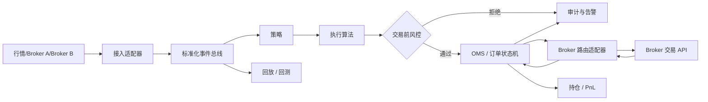

# 系统架构

## 总体视图

## 两条路径

**交易热路径**：行情适配器 → 策略 → 执行算法 → 同步交易前风控 → OMS → 路由适配器 → Broker。它只做确定性决策，禁止同步调用数据库、远程配置或不受控日志。

**控制与数据路径**：配置、权限、风控限额、审计落库、指标、报表、历史数据和对账。它与热路径通过异步事件或快照交互，故障不得拖慢或阻塞撤单。

## 多 Broker 接入契约

每个 Broker 实现交易与行情两个端口（`TradeApi`、`QuoteApi`）：

- 将认证、会话、重连、心跳、节流和协议错误封装在适配器内。
- 负责标准订单与 Broker 字段间的显式映射，映射文件存入 `resources/broker-mappings/`。
- 保留原始消息与标准化事件的关联 ID，支持对账。
- 严格保证请求幂等；不依赖网络超时来判断订单失败。

## 线程与进程建议

初版使用单个 `qts_server` 进程：I/O 线程只收发和解码，按分区投递至策略/OMS 工作线程。策略按 `strategy_id` 分片，同一账户的订单状态在一个串行分区内处理。

生产拆分时，优先独立部署 Market Data、Execution Gateway、OMS/Risk 和 Research 服务；接口通过 Protobuf 定义，事件记录作为跨进程恢复的权威来源。

## 故障处理原则

- 行情断开：标记数据陈旧，策略按配置停止开仓或只允许减仓。
- Broker 断开：冻结新单，保留撤单/查询恢复通道，重连后以 Broker 事实回报对账。
- OMS 重启：加载最近快照并回放事件账本，随后主动查询未终结订单。
- 风控服务异常：默认拒绝新风险订单；减仓/风控平仓需有独立受控策略。

