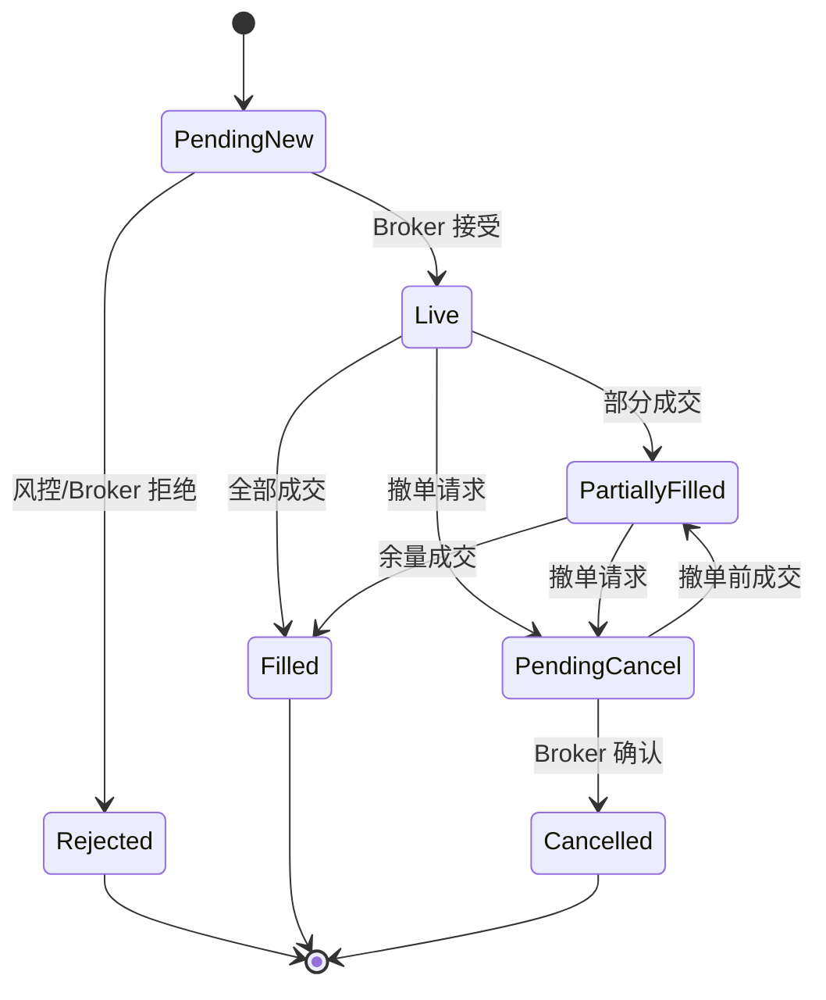

# 领域模型与订单状态机

## 核心对象

- `Instrument`：规范化合约标识、交易所、币种、最小变动价位、数量单位和交易时段。
- `MarketDataEvent`：行情源、交易所时间、接收时间、序列号、报价/成交内容与质量状态。
- `OrderIntent`：策略或算法表达的交易意图，含账户、策略、标的、方向、数量、价格和有效期。
- `Order`：OMS 受理后的订单，带全局 `OrderId`、路由、当前状态、累计成交和版本号。
- `ExecutionReport`：Broker 回报的标准化表达，含外部回报 ID、成交、拒绝原因和原始消息关联；ADR-032 另带柜台委托号（`broker_order_id`，撤单/重启对账用）与结构化拒单码（`reject_code`）。
- `RiskDecision`：规则版本、决定、触发规则、输入快照和追踪 ID。

## 状态机

状态转换由 OMS 单点管理。每个请求必须带客户端幂等键；重复回报不应改变累计成交或持仓。

## 风控层次

1. **硬性交易前规则**：交易开关、标的白名单、价格/数量/名义金额、仓位、杠杆、订单频率、自成交。
2. **策略与组合风险**：净/毛敞口、行业/币种集中度、日内损失、回撤、相关性限额。
3. **市场质量保护**：行情陈旧、价差异常、波动中断、交易时段和交易所状态。
4. **操作控制**：账户、策略、全局三级 kill switch；所有触发均写入审计事件。

